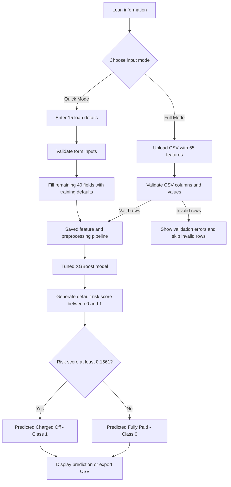
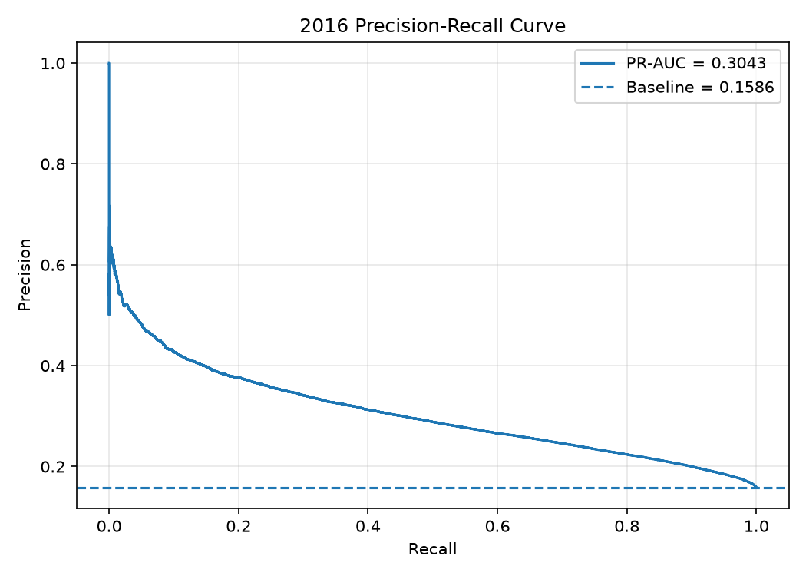

# 📊 LendingClub Loan Default Risk Prediction

A machine learning project that predicts **loan default risk** using historical LendingClub loan data. It explores how data quality, feature selection, preprocessing, and model choice affect predictions, and evaluates the final model on a **future-year test set**.

The goal is not just to label a loan as risky or safe, but to **rank loans by default risk** so that higher-risk cases can be identified for further review.

## 📌 Problem Statement

Predict whether an issued loan will be **Fully Paid (0)** or **Charged Off (1)** using information available around loan origination. Since the final model uses the lender-assigned interest rate, it represents **post-pricing, origination-stage risk assessment**, not a model for decisions made before the lender prices the loan.

This is an imbalanced binary-classification problem: only about **15%** of the selected loans were charged off. For that reason, we emphasize **Precision–Recall AUC (PR-AUC)** and default detection rather than accuracy alone.

## 📂 Dataset

The project uses historical **LendingClub** records, originally covering **2007–2020 Q3**.

| Item | Details |
|---|---|
| Original archive | 2,925,493 loan records; 142 source columns |
| Selected loans | Issued, 36-month loans from 2013–2016 with resolved outcomes |
| Final cohort | **869,540 loans** |
| Fully Paid (0) | 741,370 (85.26%) |
| Charged Off (1) | 128,170 (14.74%) |
| Final model inputs | **55 raw features** |

Unresolved loans (such as `Current`) were excluded because their final repayment outcome was not known. Restricting to 36-month loans keeps repayment horizons consistent.

### Chronological data split

| Split | Period | Loans |
|---|---|---:|
| Training | Jan 2013 – Sep 2015 | 457,355 |
| Validation | Oct 2015 – Dec 2015 | 88,810 |
| **Final test** | **Jan 2016 – Dec 2016** | **323,375** |

The 2016 outcomes were reserved for the final evaluation, rather than used to tune the model or choose features based on target performance.

## 🧠 How the Model Was Built

1. **Data audit and EDA:** Check missing values, unusual records, feature availability over time, and possible data leakage.
2. **Feature selection:** Remove post-loan information and identifiers; set aside late-introduced, sparse, or nearly duplicate predictors where justified.
3. **Preprocessing:** Parse numeric fields, impute missing values using training-only statistics, handle categorical values, and preserve useful missingness signals.
4. **Baseline models:** Compare a majority-class baseline, Logistic Regression, Decision Tree, Random Forest, and Balanced Random Forest.
5. **Model improvement:** Test feature additions, boosting algorithms, ensembles, outlier removal, and PCA; keep changes only when validation supports them.
6. **Final evaluation:** Select the best model and classification threshold using validation data, then measure performance once on the 2016 holdout set.

### Why XGBoost?

**Logistic Regression** provided a useful, interpretable baseline but was limited in capturing nonlinear interactions. A single **Decision Tree** performed worse on ranking metrics, while **Random Forest** improved ranking but did not reliably identify defaults at a 0.5 threshold. Class balancing improved recall, but not overall PR-AUC.

**XGBoost** was selected because it achieved the highest final validation PR-AUC, slightly outperformed CatBoost on ROC-AUC, and trained faster in the recorded comparison. Some tested changes—such as extra ratio features, PCA, global IQR outlier removal, and stacking—did not provide enough improvement to retain.

The model keeps `purpose` and `int_rate`; lender grades (`grade` and `sub_grade`) were not retained after feature-ablation experiments. Loan-servicing and repayment fields were excluded to prevent target leakage.

## 🖥️ How the System Works

The project has two stages: **model development** (done offline using historical loans) and **risk prediction** (using the saved model). A prediction does **not** retrain the model.

### Prediction flow




The **risk score** expresses the model's estimated relative risk. For example, a score of `0.23` is above the saved threshold (`0.1561`), so the system **flags the loan as a predicted default**. This is a classification for further review, **not a guarantee of what will happen or an automatic loan decision**.

### Using the Streamlit interface

Run `streamlit run app/app.py` from the project directory. The interface provides two ways to make predictions:

| Mode | How to use it | Output |
|---|---|---|
| **Full Mode — CSV** | Download the input template, fill in the **55 required feature columns**, and upload a CSV with one or more loans. | Risk score and predicted class for each valid loan; invalid rows are skipped with an explanation. Download all results as `loan_predictions.csv`. |
| **Quick Mode — 15 Inputs** | Manually enter 15 common loan and borrower details. The system fills the **remaining 40 features** using historical training-data defaults. | Risk score, predicted class, and saved threshold for one loan. |

**Full Mode is recommended** because it uses all 55 inputs from the supplied records. Quick Mode is only a convenient demonstration and can be less reliable because many values are filled with historical defaults. Missing *values* in otherwise present optional Full Mode columns are handled by the saved preprocessing pipeline; required columns must still exist.

### What happens behind the scenes?

1. **Validate:** The app checks required columns and essential loan values. For batch CSVs, it reports invalid rows instead of silently giving them predictions.
2. **Transform:** `src/loanrisk/features.py` prepares the loan fields, and the saved preprocessing pipeline handles numeric and categorical features using transformations learned from training data.
3. **Predict:** `src/loanrisk/predict.py` loads `saved_models/best_pipeline.pkl` and runs the trained XGBoost classifier to produce a default-risk score.
4. **Classify:** The system applies the **validation-selected threshold** (`0.1561`), rather than the usual `0.50` cutoff, to flag more potential defaults.
5. **Display/export:** The app shows the score, predicted class, and threshold. Full Mode also allows downloading a CSV with predictions and any row-validation errors.

The application uses a **local, previously trained model**; it does not fetch live credit records or independently verify applicant information. Because interest rate (`int_rate`) is an input, predictions are intended for **after the loan has been priced**.

## 📈 Model Results

### Final model comparison (2015 validation)

| Model | PR-AUC | ROC-AUC | Best F1 |
|---|---:|---:|---:|
| **Tuned XGBoost** | **0.2991** | **0.7149** | 0.3644 |
| Tuned CatBoost | 0.2980 | 0.7147 | **0.3647** |

*PR-AUC was the primary model-selection metric; F1 was used to choose and interpret an operating threshold.*

### Final XGBoost performance (unseen 2016 loans)

| Metric | Score |
|---|---:|
| **PR-AUC** | **0.3043** |
| ROC-AUC | 0.7040 |
| Precision (defaults) | 0.2675 |
| Recall (defaults) | 0.5926 |
| F1-score (defaults) | 0.3686 |
| Balanced accuracy | 0.6433 |
| Classification threshold | 0.1561 |

At this threshold, the model identified **30,401 of 51,299 defaults** in the test set. Among the **10% of loans ranked highest-risk**, the observed default rate was **36.50%**, compared with **15.86%** overall (a **2.30× lift**).



*Precision–Recall curve for the independent 2016 test set. The dashed reference represents the overall default rate.*

## 📁 Project Structure

```text
P2P-Lending-Default-Prediction/
├── README.md
├── requirements.txt
├── EDA_CONCLUSIONS.md          # EDA findings and feature decisions
├── config/                     # Feature manifest and model configurations
├── notebooks/
│   ├── 00_dataAudit_and_reproducibility.ipynb
│   ├── 01_eda.ipynb
│   ├── 02_preprocessing.ipynb
│   ├── 03_baseline_models.ipynb
│   ├── 04_model_improvements.ipynb
│   ├── 04B_quick_mode_validation.ipynb
│   ├── 05_final_evaluation.ipynb
│   ├── 06_outlier_experiment.ipynb
│   └── 07_pca_experiment.ipynb
├── src/loanrisk/
│   ├── features.py             # Feature preparation
│   ├── preprocessing.py        # Training-fitted transformations
│   ├── train.py                # Model search and selection
│   ├── predict.py              # Saved-model prediction
│   ├── evaluate.py             # Frozen 2016 evaluation
│   └── quick.py                # Reduced-input inference
├── reports/
│   ├── data_audit/
│   ├── eda/
│   ├── preprocessing/
│   ├── modeling/
│   ├── outlier_experiments/
│   ├── pca_experiments/
│   └── evaluation/2016_frozen/ # Metrics, plots and predictions
├── saved_models/               # Saved model pipelines
├── app/app.py                  # Optional Streamlit interface
└── tests/                     # Pipeline and inference checks
```

**Local data:** Large raw and intermediate files are not included in Git. The training and evaluation scripts expect `data/interim/lendingclub_2013_2016_36m_raw.parquet`, which must be prepared locally from the LendingClub source data.

## ⚙️ Installation and Usage

**1. Clone the repository**

```bash
git clone https://github.com/kaushal-trada/P2P-Lending-Default-Prediction.git
cd P2P-Lending-Default-Prediction
```

**2. Install dependencies**

```bash
python -m venv .venv
# Activate the environment, then run:
python -m pip install -r requirements.txt
python -m pip install xgboost catboost
```

> `xgboost` and `catboost` are used by the training code but are not currently listed in `requirements.txt`, so install them separately.

**3. Explore and prepare the data**

Open the notebooks in `notebooks/`, starting with `00_dataAudit_and_reproducibility.ipynb`. Make sure the local interim Parquet file exists before running training or evaluation.

**4. Train or evaluate (from the repository root)**

For **PowerShell**:

```powershell
$env:PYTHONPATH = "src"
python -m loanrisk.evaluate
# Optional retraining (overwrites the saved best model):
# python -m loanrisk.train --force
```

The evaluation command uses the saved pipeline and the independent 2016 records. Retraining requires the local dataset and can take longer; use `--force` only if you intend to replace `saved_models/best_pipeline.pkl`.

**5. Optional interface**

```bash
streamlit run app/app.py
```

## 📊 Outputs

Detailed experiment results are available in `reports/`, including baseline comparisons, model-tuning tables, data audits, final test metrics, ROC/PR curves, calibration, risk deciles, and monthly stability. The selected prediction pipeline is saved in `saved_models/best_pipeline.pkl`.

## ⚠️ Limitations

- The model was trained on **issued loans with resolved outcomes**; rejected applications and ongoing loans are not represented.
- Results apply to the selected **36-month, 2013–2016 cohort** and may change in other periods or loan types.
- Because `int_rate` is an input, this is a **post-pricing** risk model, not an independent pre-approval credit score.
- Predicted scores are useful for **relative risk ranking**, but are not perfectly calibrated probabilities.
- The selected threshold favors identifying more defaults and therefore produces many false positives. This is a **research and decision-support project**, not an automated lending approval system.

---

**Built with:** Python, Polars, pandas, scikit-learn, XGBoost, CatBoost, Jupyter, and Streamlit.
